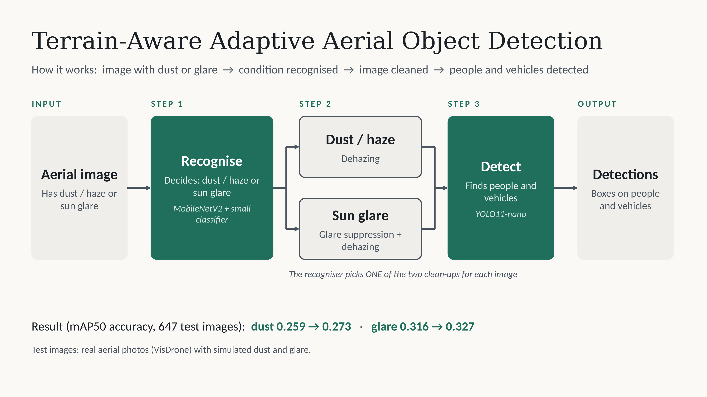

# Terrain-Aware Adaptive Aerial Object Detection

Recognise dust/haze or sun glare in a drone image, apply the matching classical clean-up, then detect objects with YOLO11n.

Course project (Artificial Neural Networks), Amrita Vishwa Vidyapeetham, Chennai.
Author: **P Venkat Pavan** (CH.SC.U4CYS24043), Cyber Security (CYS) programme.

## What it does

Border-surveillance drones fly over desert and coastal terrain, where airborne dust and low-sun glare lower detector accuracy. This project tests a simple, training-free alternative to retraining the detector:

1. **Recognise** the degradation: a frozen MobileNetV2 feature extractor plus a logistic-regression classifier (dust/haze vs. sun glare).
2. **Clean up** with the matching classical routine:
   - Dust/haze: dark-channel-prior dehazing (strength 0.7).
   - Sun glare: tone compression (0.2) + CLAHE, then milder dehazing (0.4).
3. **Detect** with YOLO11n fine-tuned on VisDrone2019-DET (10 classes).

The detector is never trained on degraded or restored images.

## Results

Evaluated on 647 VisDrone validation images (34,467 instances) with **simulated** dust and glare at severity 0.5. Metric: mAP50.

| Condition | Clean | Degraded | After clean-up | Gain |
|-----------|-------|----------|----------------|------|
| Dust / haze | 0.360 | 0.259 | 0.273 | +0.014 (5.4% relative) |
| Sun glare   | 0.360 | 0.316 | 0.327 | +0.011 (3.5% relative) |

- Recogniser accuracy (5-fold, grouped by base image): **94.7%** dust, **95.8%** glare.
- Clean-up chosen by the recogniser: 0.274 (dust) and 0.328 (glare), the same as choosing the correct clean-up by hand.
- The gain comes mainly from higher recall (dust 0.294 to 0.314, glare 0.348 to 0.359).

## Honest caveats

- Dust and glare are **simulated**; no real dusty or glaring aerial footage was tested.
- A single dehazing step performed about as well as the condition-specific ones in an ablation (on glare images, the dust fix scored 0.331 vs. 0.327), so this project does **not** show that the recognition stage improves accuracy.
- Dehazing strengths were tuned on a 60-image subset of the same validation images, with no separate held-out set.
- One run, one severity, no confidence intervals, and no comparison with published methods.
- VisDrone scenes are urban, not desert or coastal terrain.
- On a high-contrast beach photo, dehazing at 400 px produced blocky patches. The mAP numbers do not capture this.

Details are in the paper (see below).

## Repository contents

| File | Purpose |
|------|---------|
| `terrain_aware_pipeline_v2.ipynb` | Main notebook: dataset rebuild, simulation, clean-up, evaluation, ablation, classifier and demo |
| `Terrain_Aware_Aerial_Detection_Paper.pdf` / `.docx` | 9-page conference-style paper |
| `pipeline.png` / `architecture_diagram.pdf` | Pipeline diagram |
| `final_presentation.pptx`, `ann_review2.pptx` | Presentation slides |
| `data.yaml` | Dataset config for Ultralytics |
| `cell_paper_figure.py` | Makes the before/after figure with detections |

## How to run

Runs on Kaggle with a T4 GPU.

1. Create a Kaggle notebook and attach your VisDrone dataset and the trained `best.pt` as inputs.
2. Upload `terrain_aware_pipeline_v2.ipynb` (File, Import notebook).
3. Run the cells in order, one at a time:
   - Check inputs, then install packages (`ultralytics albumentations scikit-learn joblib gradio "typing_extensions>=4.16.0"`).
   - Rebuild and verify the dataset.
   - Full path: headline evaluation, end-to-end check, ablation.
   - Demo path: train the classifier, then launch the demo.
4. If the working folder was cleared, use the quick path to regenerate only the degraded images.

Notes:
- `/kaggle/working` is wiped when a session resets, so re-run from the dataset rebuild cell.
- Do **not** sort the image file list. The detector was trained on the unsorted shuffled split (seed 42).
- Degraded images are regenerated randomly, so expect differences of about 0.002 mAP50 between runs.
- Launch the demo with `!python -u demo_app.py` (a separate process) to avoid import errors after installing packages.

## Demo

A small Gradio app shows the image as received and after clean-up, each with detections, plus a plain-language summary (recognised condition, confidence, detection counts, validated recovery figures). The recogniser reads the degradation in the pixels, not the scene: an unmodified beach photo is not a valid test of the dust recogniser. Use images that already contain haze or flare.

## Settings

| Item | Value |
|------|-------|
| Detector | YOLO11n, 30 epochs, 768 px |
| Dark channel | 15x15 patch, omega 0.95, t0 0.1 |
| Working size for dehazing | 400 px (long side) |
| Recogniser | MobileNetV2 features (1280-d) + LogisticRegression, 300 images per class |
| Severity | 0.5 |
| Split seed | 42 |

## Acknowledgements and references

- VisDrone: Zhu et al., "Detection and tracking meet drones challenge," IEEE TPAMI, 2022.
- YOLO11: Ultralytics.
- Dark channel prior: He, Sun and Tang, CVPR 2009.
- Related work discussed in the paper: RESIDE, IA-YOLO, BAD-Net, HazyDet.

## License

Add a license before making the repository public. VisDrone and Ultralytics have their own terms.
